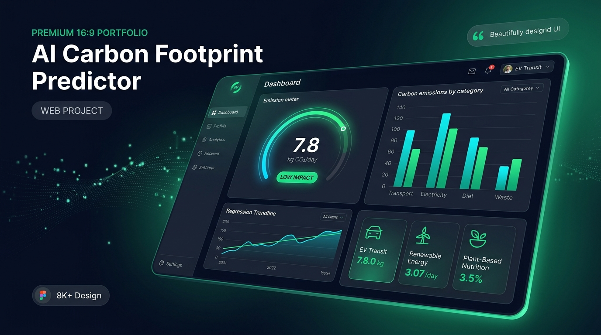
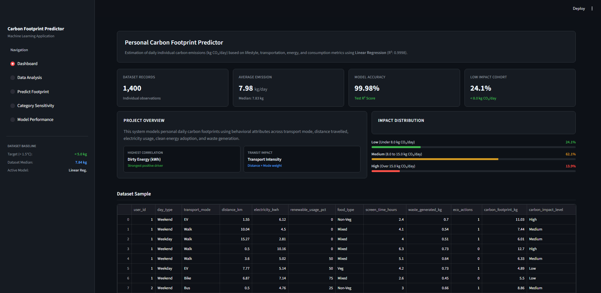
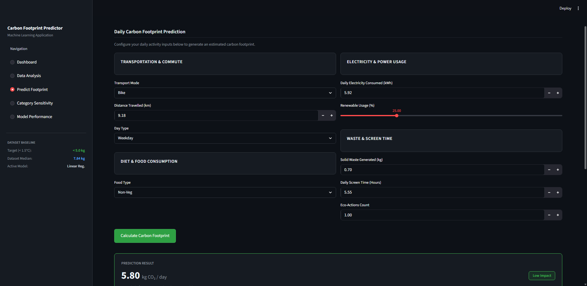
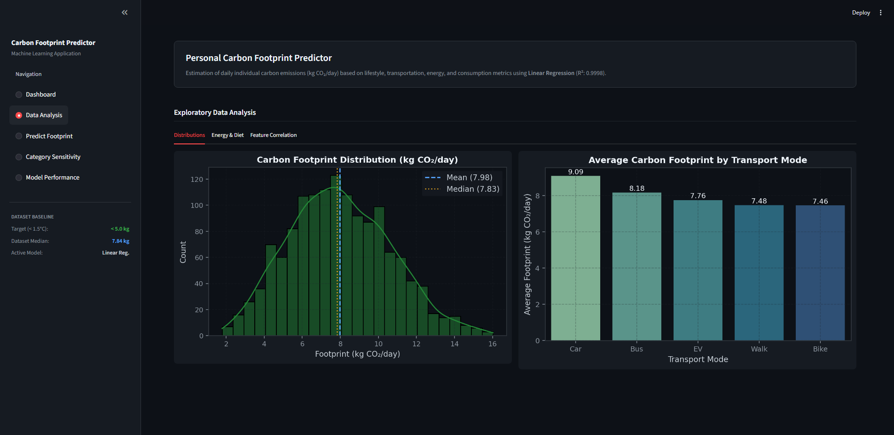
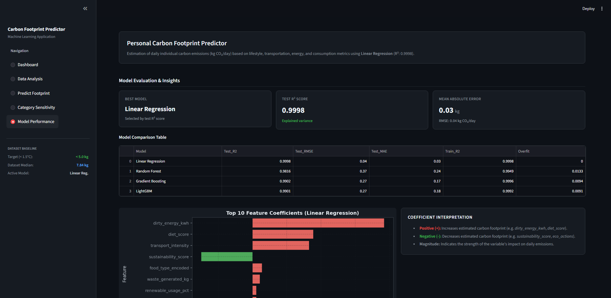

# VerdeTrack | Carbon Predictor



AI & Machine Learning powered Streamlit application for predicting daily personal carbon footprints using behavioral and lifestyle consumption patterns.

## Project Overview

This project uses a behavioral carbon-footprint dataset and a trained machine learning model to estimate daily carbon emissions (`carbon_footprint_kg`). The application also includes EDA visualizations and model insights.

### Main Features
- Predicts daily carbon footprint in kg CO₂/day
- Streamlit web application
- EDA dashboard and visualizations
- Machine learning based prediction system
- Model insights and feature analysis
- Interactive user input system

## UI Showcase

### 1. Executive Operations & Telemetry Dashboard


### 2. Full Scenario AI Inference Engine


### 3. Climate & Behavioral Analytics (EDA)


### 4. Machine Learning Model Diagnostics


## Dataset

The main dataset used in this project:
- `personal_carbon_footprint_behavior.csv`

### Main Columns
- `user_id`
- `day_type`
- `transport_mode`
- `distance_km`
- `electricity_kwh`
- `renewable_usage_pct`
- `food_type`
- `screen_time_hours`
- `waste_generated_kg`
- `eco_actions`
- `carbon_footprint_kg`
- `carbon_impact_level`

## Machine Learning Techniques Used
- Linear Regression
- Random Forest Regressor
- Gradient Boosting Regressor
- LightGBM Regressor

## Technologies Used
- Python
- Streamlit
- Pandas
- NumPy
- Scikit-learn
- Matplotlib
- Seaborn

## Project Structure

```text
.
├── app.py
├── Mini_Project.ipynb
├── personal_carbon_footprint_behavior.csv
├── carbon_dataset_1.csv
├── best_model.pkl
├── best_model_name.pkl
├── scaler.pkl
├── label_encoders.pkl
├── feature_columns.pkl
├── Carbon_Footprint_Report.docx
├── Carbon_Footprint_Predictor.pptx
└── README.md
```

## Installation

### Install Required Libraries

```bash
pip install streamlit pandas numpy joblib matplotlib seaborn scikit-learn lightgbm xgboost
```

## How to Run the Project

Run the Streamlit app:

```bash
streamlit run app.py
```

Then open the local URL shown in the terminal.

## Important Note

In `app.py`, make sure dataset paths are written like this:

```python
pd.read_csv("personal_carbon_footprint_behavior.csv")
```

instead of system-specific paths.

## Project Highlights
- Data preprocessing
- Feature engineering
- Machine learning model training
- Carbon footprint prediction
- Streamlit deployment
- Data visualization and EDA

## Collaboration

This project was developed as a group academic project in collaboration with teammates.

Project Team:
- Dakshesh Parmar
- Kaushik Ajani
- Diya Kukadia

## Guide

Project Guide:
- Nikunj Bosamiya
